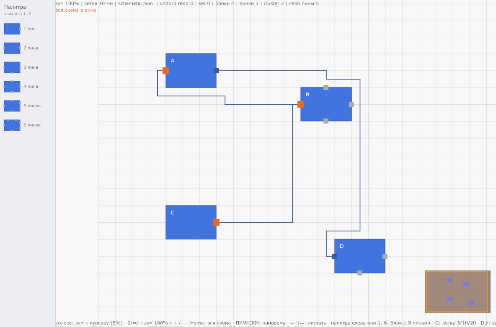
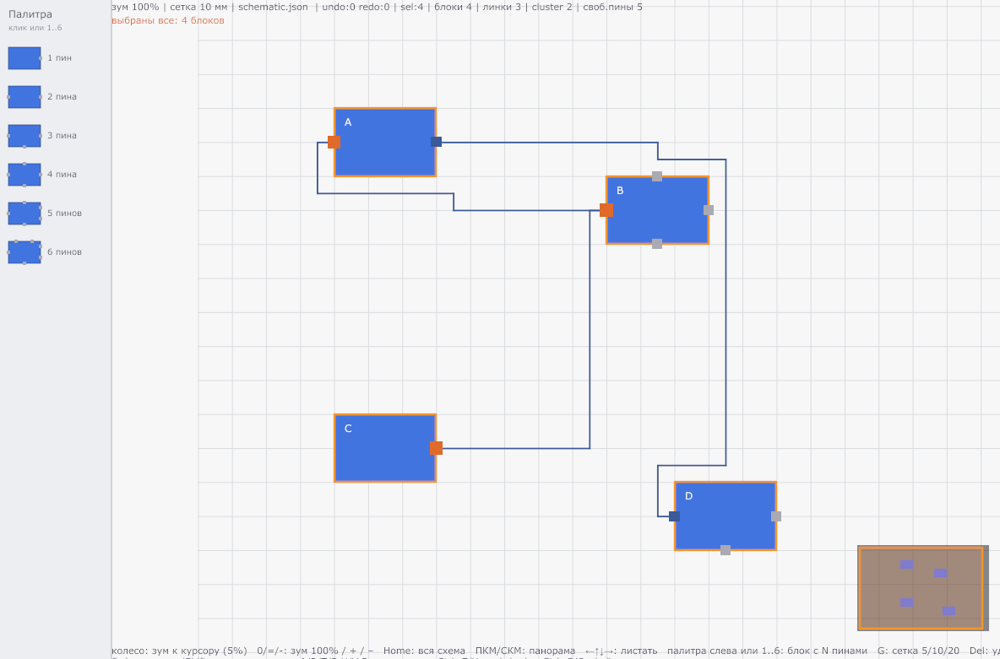

# el_chema_editor

Stage 1 circuit editor in Go: blocks, connectors, orthogonal routing, undo/redo, JSON save/load, Gio UI.

Редактор электрических схем на Go (Stage 1): блоки, коннекторы, ортогональная трассировка, undo/redo, сохранение в JSON.



## Что это

Stage 1 — это **редактор**: нарисовать схему, аккуратно развести связи, разложить блоки, сохранить в JSON и вернуться к работе потом. Моделирования здесь ещё нет.

- Блоки с 1–6 пинами, связи между пинами, junction-пины на общих узлах.
- Ортогональная трассировка с инвариантом «без hairpin»: если маршрут разворачивается назад, берётся более короткий путь.
- Инвариант «блоки не накладываются»: после перемещений позиции разводятся на ближайшие свободные узлы сетки.
- Выравнивание и распределение выделенных блоков, undo/redo, буфер обмена, сохранение/загрузка JSON (v1).
- Мир измеряется в миллиметрах, 100% зума = 4 px/мм, блок по умолчанию 30×20 мм, координаты привязаны к сетке.

Физика, симуляция и netlist — следующие стадии, в Stage 1 их нет.

## История проекта

Ремейк моего школьного проекта, для моделирования эл схем. Тогда это был turbo pascal 7 + turbovision.
Позволял накидать эл схему постоянного/переменного тока, и исследовать переходные процессы в ней.
Код с годами был утерян.
Сейчас это попытка с 0 написать на Go.

В настоящий момент отлаживаю рендеринг схем оптимальным способом.

## Возможности

### Блоки и связи

- Палитра слева (132 px): клик по строке ставит блок с 1–6 пинами в центр видимой канвы.
- Клавиши `1`–`6` ставят блок с нужным числом пинов прямо под курсором.
- Связь тянется от пина к пину; на общем узле появляется junction-пин.
- `Del` удаляет выделенный линк, иначе — блок под курсором.

### Выделение и раскладка

- Рамкой на пустом месте, `Shift`+клик по блоку, `Ctrl+A` — выбрать все.
- `A`/`R` — выровнять по левому/правому краю, `T`/`B` — по верху/низу, `H`/`V` — по центрам.
- `D` — распределить с равными промежутками (`Shift+D` — по вертикали).
- `Ctrl+C` / `Ctrl+V` — копировать и вставить выделенное.

### Навигация и история

- Сетка 5/10/20 мм по клавише `G`, стрелки — сдвиг вида на шаг сетки (`Shift`+стрелки — впятеро дальше).
- `-`/`=` — зум, `0` — 100%, `Home` — вся схема в окно.
- Мини-карта 150×96 px в правом нижнем углу: клик переносит зону видимости.
- `Ctrl+Z` — undo, `Ctrl+Shift+Z` или `Ctrl+Y` — redo; шаг истории — от нажатия до отпускания, то есть драг отменяется целиком.
- `Ctrl+S` — сохранить, `Ctrl+O` — открыть (JSON v1, по умолчанию `schematic.json`).

## Сборка и запуск

```powershell
go build -o shbuilder.exe ./cmd/shbuilder
.\shbuilder.exe              # откроет schematic.json, а если файла нет — соберёт демо-сцену
.\shbuilder.exe my.json      # открыть конкретный файл
```

GUI — [Gio](https://gioui.org) v0.10.3, сборка без cgo (`CGO_ENABLED=0`). Go 1.27+.

## Структура репозитория

```
cmd/shbuilder/     GUI: ввод, отрисовка, хоткеи, палитра, мини-карта
internal/core/     документ, блоки, линки, история, раскладка, наложения, JSON
internal/geom/     геометрия, камера, трассировка, коридоры (lanes), taps
spike/gio/         отдельный спайк на Gio
spike/wails/       отдельный спайк на Wails (нужен -tags desktop,production)
```

## Документация

- [`ideas.md`](ideas.md) — спецификация: задача (§1), архитектура (§3), правила трассировки (§4.6), дорожная карта (§8, §13.3).
- [`docs/ALGORITHMS.md`](docs/ALGORITHMS.md) — как работают алгоритмы: трассировка (§1), коридоры (§2), taps (§3), наложения (§4), история (§5), раскладка (§6), топология (§7), формат файла (§8), канва (§9), инварианты (§10).
- [`DECISIONS.md`](DECISIONS.md) — ADR: Gio, две стадии, снапшоты, JSON, мм/сетка, трассировка.
- [`problems.md`](problems.md) — журнал: проблема → исправление → закрыто.

## Скриншоты

Вся схема в окне (`Home`):


Выделены все блоки (`Ctrl+A`):



## Статус

Stage 1 в работе. Сделано: блоки, связи, трассировка, раскладка, undo/redo, буфер, JSON.
Дальше по дорожной карте (`ideas.md` §8, §13.3) — и то, чего в Stage 1 принципиально нет: физика, симуляция, netlist.
